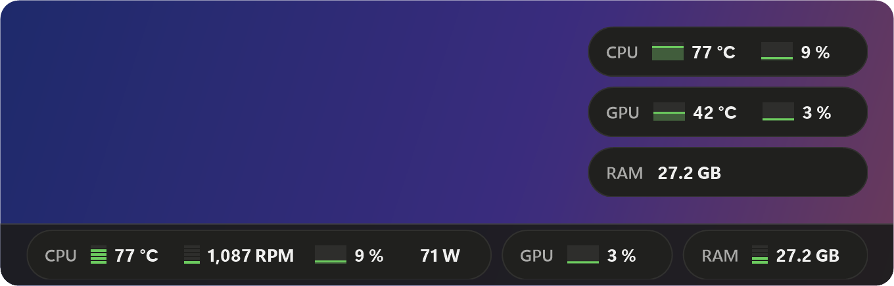

<p align="center">
  <picture>
    <source media="(prefers-color-scheme: dark)" srcset="docs/images/thermi-dark.png">
    
  </picture>
</p>

<h1 align="center">thermi</h1>

<p align="center">Your PC's temperatures, loads and FPS, always on top.</p>

<p align="center">
  
</p>

<p align="center">
  <a href="https://github.com/claudiopi/thermi/actions/workflows/ci.yml"></a>
  <a href="https://github.com/claudiopi/thermi/actions/workflows/ci.yml"></a>
  <a href="https://github.com/claudiopi/thermi/actions/workflows/mutation.yml"></a>
  <a href="https://github.com/claudiopi/thermi/actions/workflows/ci.yml"></a>
  <a href="https://github.com/claudiopi/thermi/actions/workflows/ci.yml"></a>
  <a href="LICENSE"></a>
</p>

<p align="center"><b>Windows 10 and 11 · Linux on GNOME, KDE Plasma, Hyprland, Sway and X11 desktops</b></p>

A light, always-on-top hardware monitor for Windows and Linux. CPU, GPU, RAM, fans and voltages, and on Windows the FPS of the game in front, in a small overlay you place anywhere: over the taskbar or a panel, in a corner, or floating.

**Status: v1 preview, 0.9.0.** There is no release to download yet: you build it from source and install it on your own PC. Expect rough edges, and please report them.

## What it does

- Shows the values you pick, such as temperatures, loads, power, clocks, voltages, memory, fan speeds and, on Windows, the game's FPS, in small pills that stay on top, the taskbar and the desktop's panels included.
- Colors a value at its warning and critical thresholds, and shows `–` for one it cannot read: never a zero, never an old number that looks live.
- A settings window, "Settings…" in the overlay's menu or `thermi settings`, picks the values, the look, the place, the thresholds and the hotkeys, with undo. The same window on both systems, in English and Spanish.
- Reads the sensors in `thermi-sensors`, so the overlay and the window never run as administrator. On Windows, installed for everyone, it is a small Windows service. Installed for one user without admin rights, it runs as that user and reads what those rights allow: no CPU temperature, power or clocks, board fans, drive health or FPS. On Linux it is a systemd service that runs as a user of its own, with no root and no driver, and starts when something first reads it.
- On Windows, the CPU's temperature, power and clocks need a small signed driver. When they read nothing, the settings window offers to install it, behind one Windows prompt. Linux's kernel reads them itself.
- AI agents and other programs read the sensors and change the settings with `thermi-cli`, from any shell or as an MCP server: [thermi for agents](docs/agents/README.md). For Claude Code, `claude mcp add thermi -- thermi-cli mcp`.
- Stays up to date. On Windows it updates itself silently, as a browser does: a new version is checked against thermi's signatures and switched to at a quiet moment; one that fails is set aside, and the PC stays on the one that worked. On Linux the packages add thermi's signed repository, so each version comes with the system's own updates.

## Tested on

- **The development PC**: a desktop with a Ryzen 9 9950X and an NVIDIA GeForce RTX 5060 Ti, on Windows 11.
- **The Linux PC**: a desktop with a Ryzen 9 5900X and an NVIDIA GeForce RTX 3060, on Ubuntu 26.04 with GNOME.
- **Automated tests on every change**, their count held by a ratchet in [`tests/test-count.json`](tests/test-count.json), on Windows and on Linux, where the overlay runs against headless GNOME Shell, KWin, Sway and an X11 desktop, and the packages install in clean containers of each distribution. Each [CI run](https://github.com/claudiopi/thermi/actions/workflows/ci.yml)'s dashboard shows the counts, the coverage and react-doctor's score, against the last ones on `main`. Every night, the [Bug hunt](https://github.com/claudiopi/thermi/actions/workflows/mutation.yml) plants small bugs in the code, one at a time, and measures the share the tests catch.
- **Sensor data recorded on real PCs**, which the tests replay: the Windows PC above with and without admin rights, and an Intel desktop with a Core i9-12900K, in [`tests/Thermi.Tests/Recordings`](tests/Thermi.Tests/Recordings); the Linux PC's kernel files as the service and a plain user read them, and a virtual machine's with no sensors, in [`tests/Thermi.Tests/Recordings/Trees`](tests/Thermi.Tests/Recordings/Trees).

- **Checks by hand before each release**, on the PCs above and on a virtual machine for each Linux desktop and package: what only a person can see, such as Narrator and Orca, the FPS against Zwift's own counter, installing over the last release and the start at sign-in ([`docs/RELEASES.md`](docs/RELEASES.md)).

Not tested yet, and the reports we would love most: Windows 10 22H2, an Arm64 PC, a laptop on battery, a board whose CPU fan follows the load, a taskbar at the top or a third-party one, and on Linux an Intel or AMD GPU or another board's chip. Each [hardware report](https://github.com/claudiopi/thermi/issues/new?template=hardware-report.yml) that comes in adds its PC to the list above.

## Privacy

thermi sends nothing about you or your PC.

- **On Windows**, its only connection is the update check, a minute after the service starts and every 4 hours: one HTTPS request for the channel's manifest, with no query, no cookie, no identifier and `thermi` as its whole User-Agent, and then the zip of a new version, whose signature Windows checks against the certificate authority's revocation servers, as it does for any signed program. An administrator turns updates off with the `Updates` policy value in `HKLM\SOFTWARE\Policies\thermi`, and a build from source never checks unless it is told where.
- **On Linux**, thermi itself connects to nothing. The system's own updater fetches its packages from thermi's signed repository, as it fetches the system's, or on Arch the AUR's helper does. On GNOME, the first start asks GNOME Shell to install thermi's extension from extensions.gnome.org, behind GNOME's own prompt; declined, the copy the package installed takes over at the next sign-in.

Each server sees the address a request comes from, as any server does.

## Install from source

On Windows, requires Windows 11 on x64, with PowerShell 7, the .NET SDK version in `global.json`, and Node.js 22.12 or later for the settings window's page. Windows 10 22H2 and Arm64 PCs should work but are untested.

Run this as yourself, not as administrator:

```
pwsh scripts/install.ps1
```

It builds thermi, then asks Windows for administrator rights once, to copy it to Program Files and register the `thermi-sensors` service. It also installs WebView2 where it is missing, puts `thermi-cli` on the `PATH`, and starts thermi at sign-in.

- A build from source never updates itself: run the script again to update.
- `-SensorsOnly` installs the sensors and `thermi-cli` alone, with the driver, and no overlay.
- `-Uninstall` removes thermi but keeps your settings. It leaves the driver, which other programs may use; remove it from Installed apps if nothing else needs it.

On Linux, with the same tools on an amd64 or arm64 PC, pack thermi's packages into `artifacts/linux`, then install them with the distribution's own tool:

```
pwsh scripts/linux-packages.ps1
sudo apt install ./artifacts/linux/thermi-sensors_<version>_amd64.deb ./artifacts/linux/thermi_<version>_amd64.deb
```

`thermi-sensors` alone gives the service and `thermi-cli`, for a box with no screen; `thermi` adds the overlay, the settings window and the GNOME Shell extension. On Fedora, install the `.rpm` files with `dnf`. A build from source never updates itself: pack and install it again.

## Build and test

```
pwsh scripts/check.ps1
```

## Contributing

Start with [thermi in ten minutes](docs/QUICKSTART.md) and the [architecture](docs/ARCHITECTURE.md), then read [CONTRIBUTING.md](CONTRIBUTING.md). The rules fit on one page: [AGENTS.md](AGENTS.md).

## Built with AI, in the open

thermi is built by one person with AI coding agents. [How this was built](docs/how-this-was-built.md) explains the setup and the lessons behind it.

## License

[MIT](LICENSE). The libraries thermi ships and their licenses are in [THIRD-PARTY-NOTICES.md](THIRD-PARTY-NOTICES.md).
