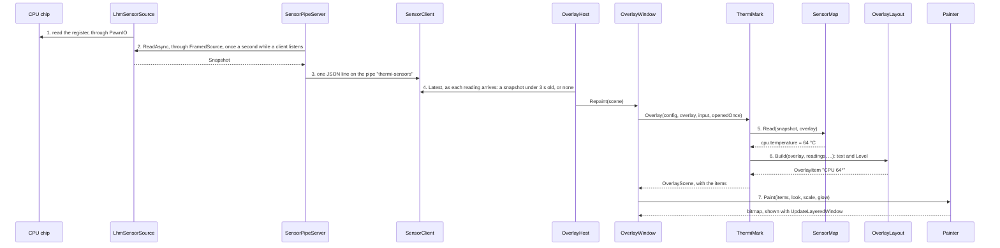
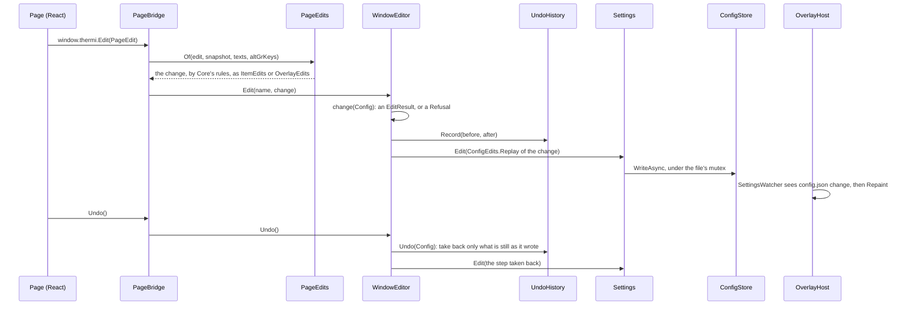
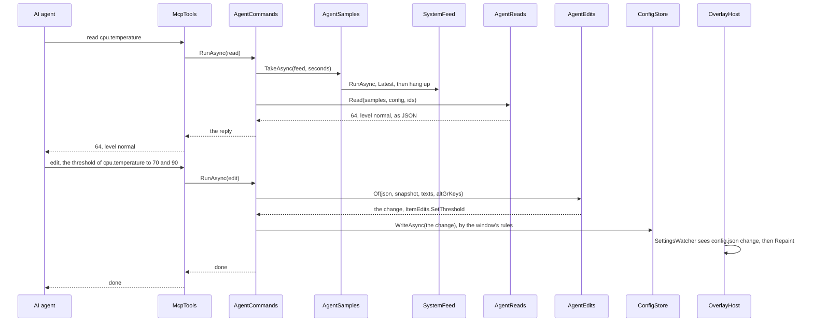
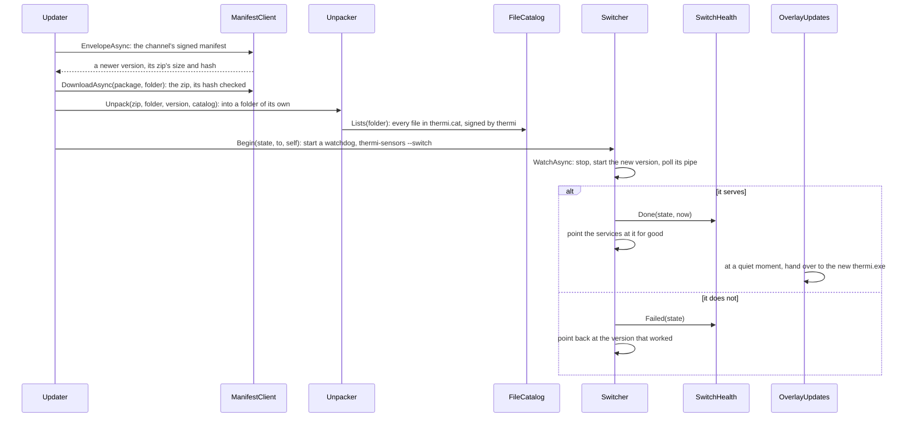

# Architecture

thermi shows your PC's temperatures, loads and fans in a small overlay that stays on top of everything, the taskbar included.
`thermi-sensors` reads the sensors: a Windows service with admin rights in a machine install, a process of yours in a per-user one. The overlay, the settings window and `thermi-cli` run as you, without admin rights.
Every decision that needs no Windows (which sensor is which, how a value reads, what the overlay shows) lives in Core and is tested from recordings of real PCs.

New here? Read [QUICKSTART.md](QUICKSTART.md) first. The reasons behind each choice are in `docs/adr`.

## How the CPU temperature gets to your screen

1. **The chip.** The CPU keeps its temperature in a register that only kernel code may read. LibreHardwareMonitor reads it through PawnIO, a small signed driver. That is why the reader runs in `thermi-sensors`, a Windows service running as SYSTEM. A per-user install has no service: `thermi-sensors --user` runs as you, and reads what your rights allow, which leaves out this register.
2. **The 1 s read.** `LhmSensorSource` updates each device once a second and turns what LibreHardwareMonitor says into a `Snapshot`: every sensor with its id, kind, name and value. A device that stalls holds back none of the others.
3. **The pipe.** `SensorPipeServer` writes the snapshot as one line of JSON to every client of the named pipe `thermi-sensors`: Core's `SnapshotWriter` sends a new client the names once, then the values alone, and the client's `SnapshotLines` turns the lines back into snapshots. In a per-user install, the overlay starts `thermi-sensors --user`, a hidden process of yours, which serves the pipe `thermi-sensors-<your SID>`, owned by you, and ends 10 s after its last client leaves. The pipe is read-only: nobody can send the sensors a command. On Linux the same lines go down a Unix socket, `/run/thermi/sensors.sock`, which systemd opens and hands the service on the first connection, through the same `SnapshotBroadcast`.
4. **The client.** In `thermi.exe`, which runs as you, `SensorClient` reads the pipe, as Linux's `SocketFeed` reads the socket, both over Thermi.App's `SensorReader`. On Linux it reads the service's socket first, and trusts it only when root or the user `thermi` serves it; only where that one is missing or refuses does it read the one `thermi-sensors --console` serves in your runtime folder, which only you and root can write, and trusts it when you or root serve it. `THERMI_SENSORS_SOCKET` names the one socket to read in their place, trusted as your own: the Linux tests' sessions set it, since unprivileged namespaces, which could hide the service's, are off on Ubuntu, so a PC with thermi installed would serve the tests its own readings. It trusts the service's pipe only when SYSTEM or Administrators own it; the per-user pipe only when you, SYSTEM or Administrators own it and `SensorPipes` finds its server running from your install folder, at an integrity level no lower than the overlay's. A snapshot older than 3 s counts as gone, and the overlay says "Sensors stopped" instead of showing old numbers. Each reading that arrives has `OverlayHost` ask each `OverlayWindow` to repaint; its once-a-second tick repaints only once no reading has come for 1.5 s, so stopped sensors still show as stopped. The window asks Core's `ThermiMark` what its overlay shows.
5. **Which sensor is "CPU temperature".** Sensor names differ between PCs. Core's `SensorMap` picks the first CPU temperature named `Core (Tctl/Tdie)`, `Core (Tctl)`, `CPU Package` or `Core Average`, and treats 0 °C as missing, since no running chip is at 0 °C.
6. **Units and colors.** `OverlayLayout` formats the value (°C or °F, the item's decimals, the width of its widest number so it never jitters) and asks the item's `Threshold` for its `Level`: by default a CPU warns 10 °C under its limit and is critical 5 °C under it.
7. **The pill.** `OverlayWindow` hands the items and the style's `OverlayLook` to `Painter`, which draws the pill with GDI+: a warning underlines the value, a critical value is drawn reversed on red. `LayeredPicture` puts the bitmap on screen with `UpdateLayeredWindow`, above the taskbar.

## The other flows

**An edit in the settings window, and its undo.** The page decides nothing: C# checks every edit with Core's rules, keeps it for undo, and writes the file the overlay watches. `PageBridge` answers the same on every OS, and asks an `IWindowHost` for what only the OS does: `WindowsHost` behind WebView2, `LinuxHost` behind WebKitGTK, in whose `SettingsWindow` the page is served from the install's `web` folder.

**An agent reads the CPU temperature and changes its threshold.** `thermi-cli` is the same program behind a console door. It answers from the pipe and the file, so it works with no overlay running.

**A silent update, and its rollback.** The service downloads and checks a version, then a watchdog switches to it and goes back if it does not serve.

## Projects

| Project | Runs as | Job |
| --- | --- | --- |
| `src/Thermi.Core` | a library, any OS | Snapshots, sensor mapping, formatting, thresholds, config and its edits and undo, layout and looks, the tray's texts, translations, the agents' answers, update decisions. Depends on nothing. |
| `src/Thermi.Sensors.Windows` | `thermi-sensors.exe`, a service as SYSTEM, or a process of the user's in a per-user install | Reads the sensors and the frames games present, serves snapshots, updates thermi, and lays a version down for the MSI and `scripts/install.ps1`. |
| `src/Thermi.App` | a library, any OS | What the overlay and the window share beyond Core, needing a package or the file system: the settings file under its mutex, the settings a host holds, the settings window's bridge, with its edits, readings and charts, each end of the overlay and the window's link (`OverlayEnd`, `WindowEnd`), a desktop gesture's press, drag, drop and undo, which each OS's surface only feeds the pointer, an overlay's value tooltips where the desktop has none (`OverlayTips`), what a hotkey, a tray icon's press and a notice's button do, the sensor service's client, the fan finder's run, and the logs. |
| `src/Thermi.Cli` | a library, any OS | `thermi-cli`'s commands and its MCP server, over what each OS answers in `IAgentEnvironment`. |
| `src/Thermi.Windows` | `thermi.exe` and `thermi-cli.exe`, as you | The overlay and tray, `thermi preview`, the settings window that hosts the page, and what an agent's command reaches on Windows. |
| `src/Thermi.Sensors.Linux` | `thermi-sensors`, a systemd service as the user `thermi`, started by its socket | Reads the kernel's sensors and NVML, serves snapshots on `/run/thermi/sensors.sock`, and records or replays a tree of the kernel's files. |
| `src/Thermi.Linux` | `thermi` and `thermi-cli`, as you, the overlay in the graphical session's user unit | The overlay on Linux: Core's overlays painted with Cairo and Pango on one GLib main loop, shown on GNOME through the Shell's extension over D-Bus, with its tray icons and hotkeys, and elsewhere as GTK windows made layer surfaces or kept above on X11, each surface only reporting the pointer to Thermi.App's gestures, its icons as StatusNotifierItems and its hotkeys through the GlobalShortcuts portal or X11's grab; its notices as the desktop's notifications; `thermi settings`, the settings window that hosts the page in WebKitGTK on GTK 4; `thermi preview`; and what an agent's command reaches on Linux. |
| `src/Thermi.Gnome` | an extension inside GNOME Shell | Shows the pictures `thermi` paints above every window and the top bar, its icons in the top bar, the Shell's own menus, takes its hotkeys, and sends back the pointer, the presses and the monitors. It decides nothing. |
| `src/Thermi.Settings.Web` | the page in WebView2 on Windows, in WebKitGTK on Linux | The settings window's page, in React and Fluent UI. It holds no logic: it reads and edits through the bridge. |
| `src/Thermi.Settings.Types` | the build | Writes the page's TypeScript and the agents' JSON Schemas from Core, then installs and builds the page once for every host, which only takes its `dist`. |
| `src/Thermi.Client` | a library other programs ship | The .NET SDK of the agents' contract. |
| `src/Thermi.Trust` | a library | Windows' own trust checks: admin-only folders, Authenticode, signed catalogs. |
| `src/Thermi.Releases` | `thermi-releases.exe`, the owner | Signs the update channels' manifests. |
| `src/Thermi.Installer` | the MSIs | The machine's and the per-user installer, built with WiX. |
| `tests/Thermi.Tests` | the test runner | Behavior from recordings, file formats, the agents' commands and MCP server, and the repo rules. |
| `tests/Thermi.Windows.Tests` | the test runner | Real pipes, the service, the painter, the settings file and the window. |

Which projects are shared and which are Windows-only, and how another OS would plug in: `docs/adr/0018-shared-and-windows-projects.md`. Why these packages and no others: `docs/adr/0006-proven-libraries-for-logging-and-win32.md`.

## Names

| Name | What it is | Where |
| --- | --- | --- |
| **Snapshot** | Every sensor thermi shows, at one moment. | `Snapshot` |
| **Recording** | A snapshot saved with `thermi-sensors --dump`, replayed by tests. | `tests/Thermi.Tests/Recordings` |
| **Catalog line** | The whole snapshot, sent on connecting and when the sensors change; other seconds send the values alone. | `SnapshotWriter` |
| **Metric** | A stable name for what the overlay shows, like `cpu.temperature`. | `Metrics` |
| **Sensor map** | The rules from a snapshot to each metric, and "zero means not read". | `SensorMap` |
| **Overlay** | One of up to four in the settings, with its items, place, style and visibility. | `OverlayConfig` |
| **Item** | One value in an overlay: a metric or a sensor, its threshold and its graph. | `ItemConfig`, `Threshold` |
| **Pill** | A run of items under one label, painted as one rounded shape. | `OverlayLayout` |
| **Look** | A style ready to draw: sizes, font, colors, where each pill goes. | `OverlayLook` |
| **Edit** | One change, which gives valid settings or a `Refusal` saying why not. | `ConfigEdits`, `ItemEdits` |
| **Undo step** | What one edit changed, taken back only where the file still holds what it wrote. | `UndoHistory` |
| **Snap** | A place on a taskbar or a corner, worked out at every paint, never written as a position. | `Snaps` |
| **Bridge** | All the page may read and ask of C#, one interface whose TypeScript the build writes. | `IWindowBridge` |
| **Host** | The overlay process's hidden window: the loop, the tick, the hotkeys, the tray. | `OverlayHost` |
| **Agent door** | `thermi-cli.exe`: commands that print one JSON document, or an MCP server. | `AgentCommands`, `McpTools` |

## Rules of the road

| Topic | Rule | Why |
| --- | --- | --- |
| Trust | The sensors never read from their pipe. The overlay trusts the service's pipe only when SYSTEM or Administrators own it, and the per-user pipe only when its owner, its server's folder and their integrity levels hold. Nothing of thermi's is raised by UAC. | `docs/adr/0003-sensor-service.md`, `docs/adr/0016-admin-on-demand.md` |
| Failure | A stuck read ends the service and Windows restarts it. A stalled device holds back none of the others. Nothing the overlay reads can crash it. | `docs/adr/0015-a-stalled-device-holds-back-none.md`, `docs/adr/0017-windows-restarts-the-overlay.md` |
| Time | Code gets time from an injected `TimeProvider`, so tests run on a fake clock. | `AGENTS.md` |
| Settings | A broken or newer file is never written over. Every writer holds the file's mutex. | `docs/adr/0005-settings-window-process.md` |
| Budget | The overlay, the idle window and the service each stay under a CPU and memory budget. | `docs/adr/0001-architecture.md`, `scripts/measure.ps1` |
| Updates | Each version has its own folder behind launchers that never move; a version runs only when its signatures hold. | `docs/adr/0008-updates.md` |
| Logs | The overlay, the window and the agents each log to `%LOCALAPPDATA%\thermi`; the service to the Application event log, and the per-user sensors to `%LOCALAPPDATA%\thermi\thermi-sensors.log`. | `AGENTS.md` |

## Where to change what

| To change | Look in |
| --- | --- |
| Which sensor feeds a metric | `src/Thermi.Core/Sensors/SensorMap.cs`, then a recording test |
| How a value reads (units, digits, °F) | `src/Thermi.Core/Look/ReadingFormatter.cs` |
| The default overlay or thresholds | `src/Thermi.Core/Settings/OverlayConfig.cs`, `src/Thermi.Core/Settings/Threshold.cs` |
| A field of the settings file | `src/Thermi.Core/Settings`, its undo in `src/Thermi.Core/Editing/ConfigFields.cs` |
| What the window may change, and why it refuses | `src/Thermi.Core/Editing` |
| A text a user reads, or a language | `src/Thermi.Core/Translations` |
| How the overlay looks | `src/Thermi.Core/Look/OverlayLook.cs` for what, `src/Thermi.Core/Painting/PaintLayout.cs` for where, each OS's `Painter.cs` (`src/Thermi.Windows/Painting`, `src/Thermi.Linux/Painting`) for how; check with `thermi preview` |
| Where the overlay snaps | `src/Thermi.Core/Placement/Snaps.cs`, fed by `src/Thermi.Windows/Win32/Desktop.cs` |
| What a tray icon shows | `src/Thermi.Core/Tray`, drawn by `src/Thermi.Windows/Tray` and on Linux by `src/Thermi.Linux/Painting`, shown by `src/Thermi.Linux/Tray`, its presses done by `src/Thermi.App/Gestures` |
| What the page shows and does | `src/Thermi.Settings.Web/src`, tested in `src/Thermi.Settings.Web/tests` |
| What the page may ask of C# | `src/Thermi.Core/Bridge/IWindowBridge.cs`, answered in `src/Thermi.App/Window` on every OS |
| What an agent's command answers | `src/Thermi.Core/Agents`, served by `src/Thermi.Cli`, which reaches Windows through `src/Thermi.Windows/Agents` |
| What the service reads | `src/Thermi.Sensors.Windows/Reading` |
| How updates switch and roll back | `src/Thermi.Core/Updates`, `src/Thermi.Sensors.Windows/Updates` |
| Install and uninstall | `scripts/install.ps1`, `src/Thermi.Installer` |

Each project's `README.md` maps its folders.
